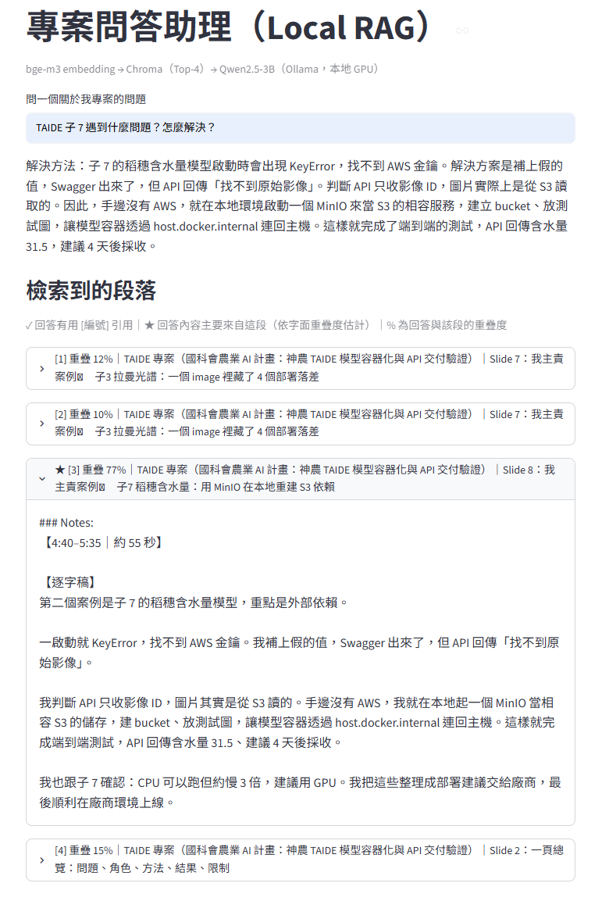

# 專案問答助理（Local RAG）

把我自己的專案簡報與備忘稿放進知識庫，用**本地 LLM** 回答「某個專案遇到什麼問題、怎麼解決」這類問題，並標出答案來自哪一段。全部在一台 GTX 1650（4GB VRAM）筆電上執行，不呼叫任何雲端 API。

除了問答流程，這個專案的重點是**評估與除錯**：自建 20 題問答集，同時算檔案層級與投影片層級的檢索命中率，並記錄從失敗案例找原因、修正、再驗證的過程。



## 架構

```
pptx 簡報 ──markitdown──▶ Markdown ──clean_docs.py──▶ 依投影片分段
                                                         │
                       ingest.py：每張投影片切成 chunk，前面加上「專案｜Slide N：標題」標頭
                                                         │
                                         bge-m3 embedding（Ollama）
                                                         ▼
問題 ──bge-m3──▶ Chroma 相似度檢索 Top-4 ──▶ Prompt（只能根據參考資料、標出處）
                                                         │
                                       Qwen2.5-3B（Ollama，本地 GPU）
                                                         ▼
                              回答 ＋ 檢索段落（標示回答主要依據哪一段）
```

| 元件 | 選擇 | 理由 |
|---|---|---|
| 框架 | LangChain | 生態系與文件完整 |
| LLM | Ollama `qwen2.5:3b` | 3B 量化後約 2GB，4GB VRAM 放得下，中文能力好；地端部署 |
| Embedding | Ollama `bge-m3` | 支援中文 |
| 向量庫 | Chroma | 不用架伺服器，存在本機資料夾 |
| 介面 | Streamlit | 介面和 RAG 核心分開（`app.py` 只是外殼，邏輯都在 `ask.py`） |

## 檔案

| 檔案 | 用途 |
|---|---|
| `clean_docs.py` | 清理 markitdown 輸出：刪圖片連結、投影片標記改成 `## Slide N`、合併空行 |
| `ingest.py` | 依投影片切分 → 切 chunk → 加上下文標頭 → 建 Chroma 索引（`python ingest.py 500`） |
| `ask.py` | RAG 核心：檢索 → 組 prompt → 生成；命令列可直接問（`python ask.py "問題" [chunk_size]`） |
| `app.py` | Streamlit 介面 |
| `eval_retrieval.py` | 檢索評估：檔案層級與投影片層級 Hit@4 |
| `debug_retrieve.py` | 除錯：列出某題的前 10 名 chunk 與距離 |
| `questions.jsonl` | 評估問答集（20 題＋1 題負例） |

## 如何執行

需要先安裝 [Ollama](https://ollama.com/)。

```bash
python -m venv .venv
.venv\Scripts\activate            # macOS / Linux：source .venv/bin/activate
pip install -r requirements.txt
ollama pull bge-m3
ollama pull qwen2.5:3b

# 準備知識庫文件（見 docs/README.md），然後：
python ingest.py 500
python ask.py "TAIDE 子 7 遇到什麼問題？怎麼解決？"
streamlit run app.py
```

> 知識庫是我的個人專案資料，沒有放進 repo。用自己的文件重現的方式見 [`docs/README.md`](docs/README.md)。

## 評估結果

問答集：四個專案共 20 題，每題標註答案所在的**檔案**和**投影片編號**；另有 1 題資料中沒有答案的負例（不計入命中率，用來測試會不會亂答）。

| chunk size | 檔案層級 Hit@4 | 投影片層級 Hit@4 |
|---|---|---|
| 300 | 20/20 (100%) | 20/20 (100%) |
| 500 | 20/20 (100%) | 19/20 (95%) |
| 800 | 20/20 (100%) | 18/20 (90%) |

- **檔案層級沒有鑑別力**：只有 4 份文件、題目常帶專案名稱，三種設定都 100%。改成投影片層級才看得出差異：chunk 越大越差，大 chunk 把投影片內容、逐字稿、追問混在一起，向量被稀釋。
- **檢索最準 ≠ 回答最好**：300 的檢索命中率最高，但每塊太短，實際問答時漏掉關鍵步驟（例如子 7 的回答少了 KeyError 和 MinIO 解法）；500 的回答完整。所以預設用 **500**。
- **負例**：問資料中沒有的內容，模型回答「資料中沒有提到」。
- **限制**：只有 20 題，三種設定的差距是 1～2 題，只能當方向、不能當結論；題目偏簡單（接近天花板）。

## 除錯紀錄（失敗案例 → 原因 → 修正）

**1. 答案在資料裡，系統卻說「資料中沒有提到」**
問「TAIDE 子 7 遇到什麼問題？」，答案在第 8 張投影片，但用 `debug_retrieve.py` 看，相關 chunk 連前 10 名都沒進；前幾名是只列出「子7」名稱的總覽表。原因是投影片被切成多塊後，備忘稿那幾塊沒有寫到主題，失去上下文。
→ 改成先依投影片切分，再在每個 chunk 前加上「專案｜Slide N：投影片標題」（contextual chunk header）。子 7 的逐字稿 chunk 從前 10 名外升到**第 3 名**。生成端其實沒錯：模型拿到的參考資料裡確實沒有答案。

**2. 檢索到了，但答案混入相似段落**
修好後，前 4 名裡有 2 塊是結構相同的「子 3」案例，3B 模型把子 3 的問題講成子 7 的。
→ 先用成本最低的方法：prompt 說明每段標頭代表出處，並要求「問題指定子計畫時只能用屬於它的段落」，回答就不再混入。檢索端的雜訊仍在，下一步是 metadata 過濾或混合檢索。

**3. 檢索有命中，生成卻把因果講錯**
「碩論為什麼從 listwise 改成 pointwise？」原文同時寫了兩件事（先修評估 bug、再找到分數跨批次尺度不一致的根因），模型把兩者混成一個原因。答案段落都有撈到，是小模型整理多步驟因果的限制。這類錯誤檔案層級 Hit@K 抓不到，需要 faithfulness 評估。

**4. 資料前處理**
- `markitdown x.pptx > x.md` 在 Windows 中文版 cmd 會存成 Big5，用 UTF-8 讀就變亂碼 → 一律用 `-o` 輸出 UTF-8。
- 範例常用的切分符號 `"\n## "` 在 markitdown 的 pptx 輸出裡根本不存在 → `clean_docs.py` 把投影片標記轉成 `## Slide N`。
- `Chroma.from_documents` 對既有資料夾是追加寫入，重跑會重複 → 建索引前先刪舊索引。

**5. 標示出處**
3B 模型常不照指示標 `[編號]`，所以介面另外計算「回答與每段的字面重疊度」，標出回答主要依據的段落（子 7 那題測試時，正確段落的重疊度明顯高於其他三段）。這是近似值，不是模型真正的引用。

## 限制與下一步

- 評估只做到檢索；生成品質（faithfulness、答案正確性）目前是人工對照 `questions.jsonl` 的 `answer` 欄位。
- 純向量檢索；尚未加入 BM25 混合檢索與 reranker（中文 BM25 需要斷詞，例如 jieba）。
- 問答集規模小、偏簡單；要加入不帶專案名稱、跨專案比較、改寫問法的題目，並固定「部分答案」的標註規則。
- 尚未 Docker 化；未做延遲與 GPU 使用率監控。
